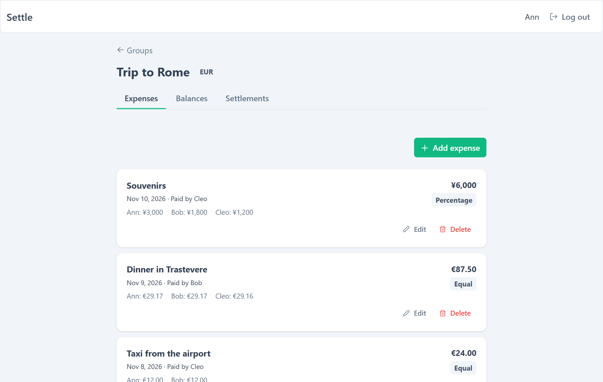
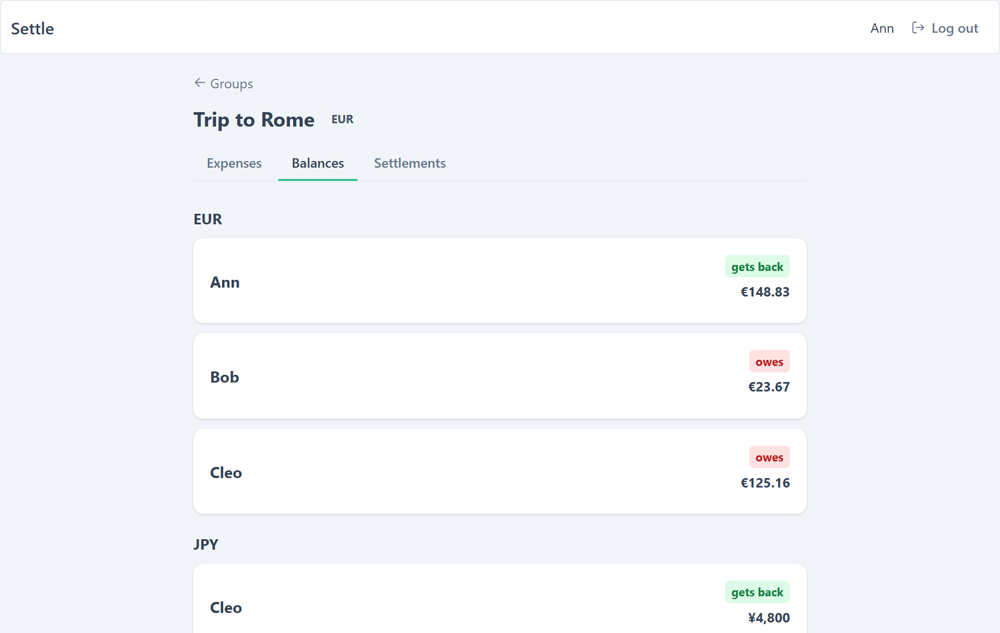
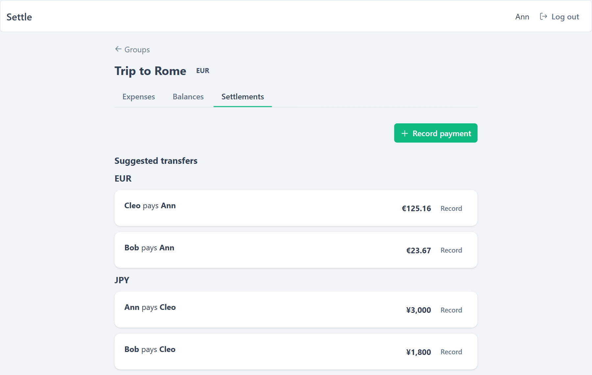
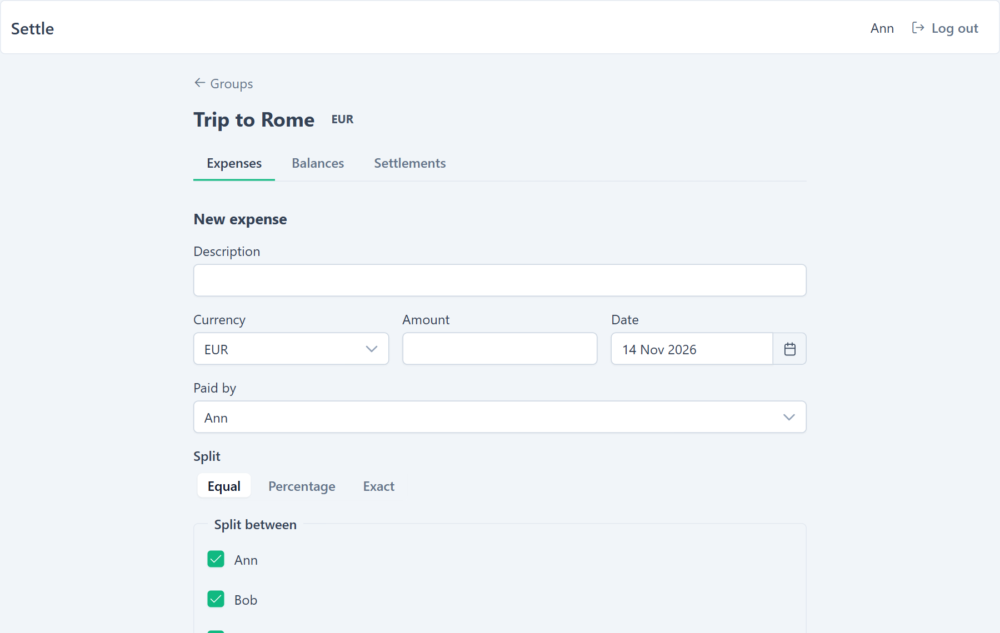

# Settle — Split Expenses with Friends

**Splitwise-style app for sharing expenses in a group, tracking who owes whom, and settling up with the fewest transfers.**


**Live site:** [settle-coral-seven.vercel.app](https://settle-coral-seven.vercel.app)

🇬🇧 English | [🇵🇱 Polski](README.pl.md)

---

## What it is

A full-stack app: a Spring Boot REST API with PostgreSQL and an Angular frontend. Create a group, add expenses split equally, by percentage or by exact amounts, and see balances plus a minimal set of transfers that settles everyone up.

---

## Screenshots

### Expenses



### Balances per currency



### Suggested transfers



### New expense



---

## Features

- **Groups** with members (up to 16), owner and member roles
- **Expenses** split equally, by percentage or exact amounts; money stored in minor units with fair rounding of leftover cents
- **Multiple currencies** — balances and transfers are computed per currency, no exchange rates
- **Settle up** — suggested transfers that clear all debts with the fewest payments
- **Auth** — httpOnly cookie sessions, refresh token rotation, CSRF protection, rate limiting of sign-in, registration and refresh
- **Reliability** — optimistic locking with ETags, pessimistic locks for concurrent writes, Caffeine caches, paginated lists
- **Quality** — Flyway migrations, integration tests on real PostgreSQL (Testcontainers), GitHub Actions CI including a Docker smoke test

---

## Tech Stack

| Layer | Technology |
|---|---|
| Backend | Java 21, Spring Boot 4.1 (Web MVC, Data JPA, Security) |
| Database | PostgreSQL 17, Flyway |
| Frontend | Angular 21 (standalone, signals, zoneless), PrimeNG |
| Tests | JUnit, Testcontainers, Vitest |
| CI / containers | GitHub Actions, Docker, nginx |
| Hosting | Vercel (frontend), Railway (backend + database) |

---

## Run locally

Needs JDK 21, Node and Docker. Copy `.env.example` to `.env` and set `JWT_SECRET` (32+ characters).

```bash
./mvnw spring-boot:run          # API on :8080, starts Postgres from compose.yaml
cd frontend && npm ci && npm start   # app on :4200
```

Everything in Docker (app on `:8081`): `docker compose -f compose.yaml -f compose.app.yaml up --build`

Tests: `./mvnw verify` (Docker must be running).
