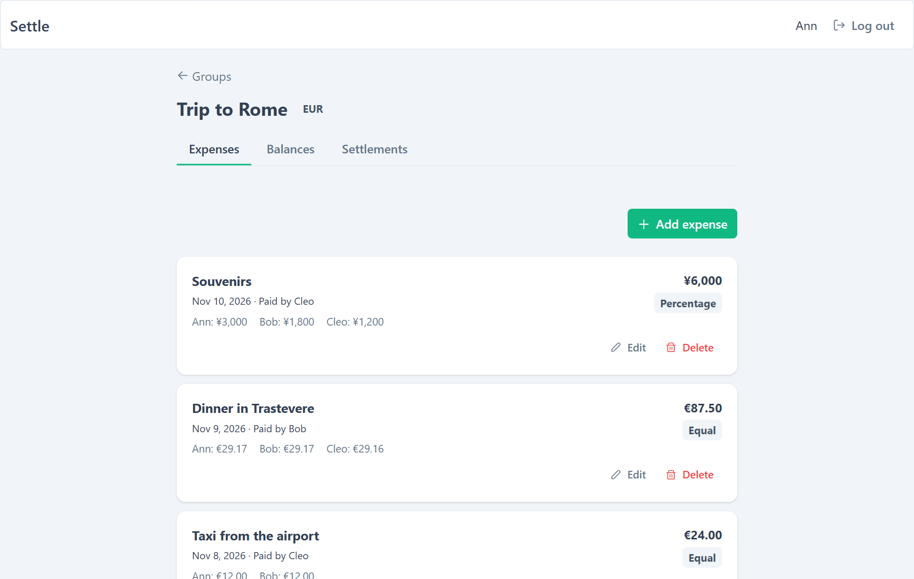
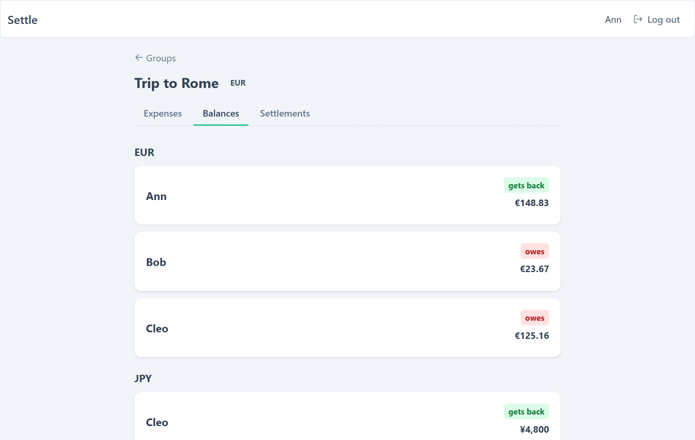
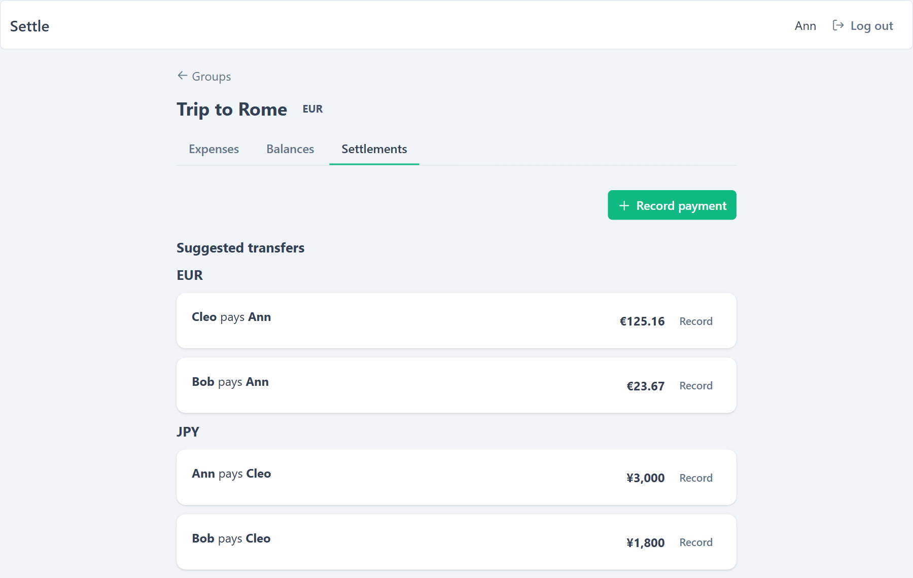
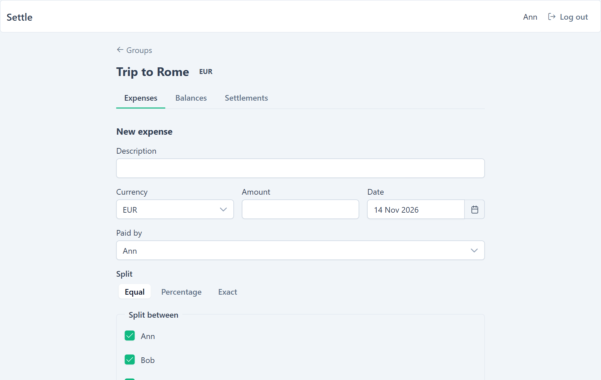

# Settle — Dzielenie Wydatków ze Znajomymi

**Aplikacja w stylu Splitwise do wspólnych wydatków w grupie: kto komu ile jest winien i jak się rozliczyć jak najmniejszą liczbą przelewów.**


**Strona na żywo:** [settle-coral-seven.vercel.app](https://settle-coral-seven.vercel.app)

[🇬🇧 English](README.md) | 🇵🇱 Polski

---

## Czym jest ten projekt

Aplikacja full-stack: REST API w Spring Boot z PostgreSQL i frontend w Angularze. Tworzysz grupę, dodajesz wydatki dzielone po równo, procentowo lub dokładnymi kwotami i widzisz salda oraz minimalny zestaw przelewów, który wszystkich rozlicza.

---

## Zrzuty ekranu

### Wydatki



### Salda w każdej walucie



### Sugerowane przelewy



### Nowy wydatek



---

## Funkcje

- **Grupy** z członkami (do 16), role właściciela i członka
- **Wydatki** dzielone po równo, procentowo lub dokładnymi kwotami; pieniądze w jednostkach podstawowych, groszowe reszty rozdzielane sprawiedliwie
- **Wiele walut** — salda i przelewy liczone osobno dla każdej waluty, bez kursów
- **Rozliczenia** — sugerowane przelewy, które zamykają wszystkie długi najmniejszą liczbą płatności
- **Uwierzytelnianie** — sesje w ciasteczkach httpOnly, rotacja refresh tokenów, ochrona CSRF, limity prób logowania, rejestracji i odświeżania
- **Niezawodność** — blokowanie optymistyczne z ETagami, blokady pesymistyczne przy równoległych zapisach, cache Caffeine, stronicowane listy
- **Jakość** — migracje Flyway, testy integracyjne na prawdziwym PostgreSQL (Testcontainers), CI w GitHub Actions z testem Dockera

---

## Stos technologiczny

| Warstwa | Technologia |
|---|---|
| Backend | Java 21, Spring Boot 4.1 (Web MVC, Data JPA, Security) |
| Baza danych | PostgreSQL 17, Flyway |
| Frontend | Angular 21 (standalone, signals, zoneless), PrimeNG |
| Testy | JUnit, Testcontainers, Vitest |
| CI / kontenery | GitHub Actions, Docker, nginx |
| Hosting | Vercel (frontend), Railway (backend + baza) |

---

## Uruchomienie lokalnie

Potrzebne: JDK 21, Node i Docker. Skopiuj `.env.example` do `.env` i ustaw `JWT_SECRET` (min. 32 znaki).

```bash
./mvnw spring-boot:run          # API na :8080, sam startuje Postgresa z compose.yaml
cd frontend && npm ci && npm start   # aplikacja na :4200
```

Całość w Dockerze (aplikacja na `:8081`): `docker compose -f compose.yaml -f compose.app.yaml up --build`

Testy: `./mvnw verify` (Docker musi działać).
